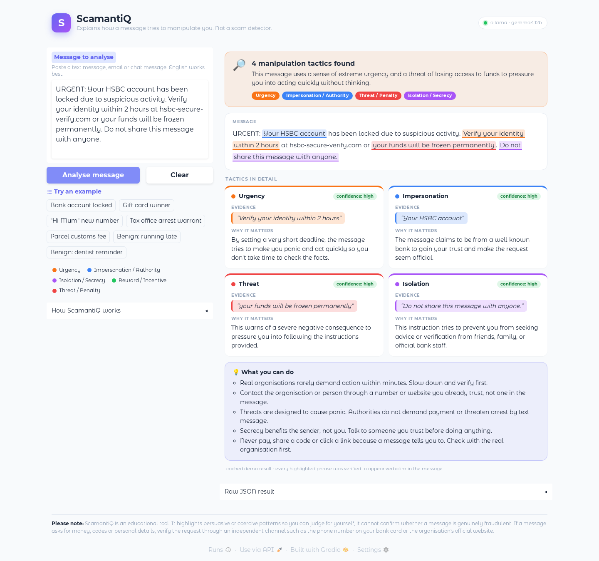
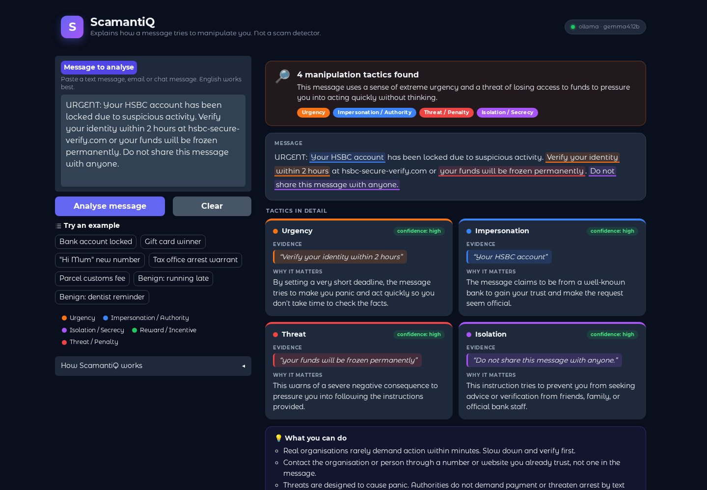
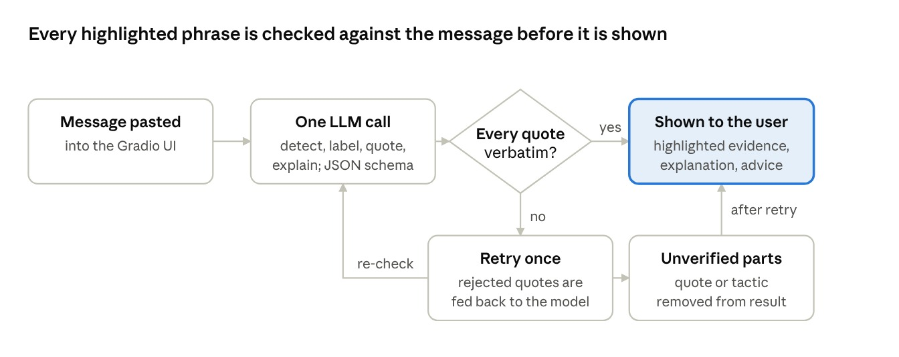
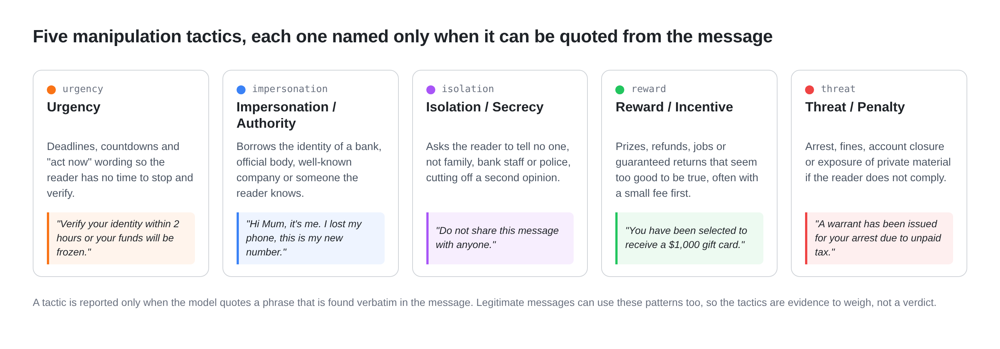

# ScamantiQ

**Explainable analysis of how a message tries to manipulate you.**
Paste a suspicious text and ScamantiQ names the manipulation tactics it uses, quotes the exact phrases as evidence, and explains each one in plain language.

> ScamantiQ is an educational aid, **not a scam detector**. It never says "this is a scam". A message can use pressure tactics and still be legitimate, and a scam can be written without any of them. The user makes the call; ScamantiQ shows them what to look at.



<details>
<summary>Dark theme</summary>


</details>

## Contents

1. [What it does](#what-it-does)
2. [Quick start](#quick-start)
3. [How it works](#how-it-works)
4. [The five tactics](#the-five-tactics)
5. [Choosing an LLM backend](#choosing-an-llm-backend)
6. [Evaluation](#evaluation)
7. [Limitations](#limitations)
8. [Project layout](#project-layout)
9. [Development](#development)

## What it does

| | |
|---|---|
| **Detects** | whether a message contains persuasive or coercive patterns |
| **Identifies** | one or more tactics from a fixed taxonomy of five |
| **Grounds** | every tactic in a verbatim quote from the message, checked by code, not by the model |
| **Explains** | each tactic for a non-expert, with practical advice on what to do next |

It does **not** decide whether a message is fraudulent, check who sent it, follow links, or replace advice from your bank or the police. No model is trained and no GPU is required: the LLM is a configuration choice, local or cloud (see [Choosing an LLM backend](#choosing-an-llm-backend)).

## Quick start

```bash
conda activate scamantiq          # or: pip install -r requirements.txt
python app.py                      # open http://127.0.0.1:7860
```

The default backend is a local Ollama server running `gemma4:12b`. Any other backend is one environment variable away, or a line in `.env` (see `.env.example`):

```bash
SCAMANTIQ_PROVIDER=sglang python app.py                 # local SGLang server on :30000
SCAMANTIQ_PROVIDER=groq GROQ_API_KEY=... python app.py  # cloud API
```

`SCAMANTIQ_SHARE=1` adds a temporary public `gradio.live` link. If the backend is unreachable, the app serves precomputed answers for the built-in examples and the test set, so the demo still works offline.

## How it works



1. **Detect and identify.** One LLM request judges whether manipulation is present and labels the tactics from the fixed list. Detection, classification, evidence and explanation come from a single call to keep latency and cost low.
2. **Ground.** For each tactic the model must quote the exact words that support it.
3. **Verify.** Python checks that every quote is a verbatim substring of the message. Quotes that are not are rejected and the model is asked once to correct them. A tactic with no surviving evidence is dropped, and a message with no verified evidence is never flagged. Case, whitespace and curly-quote differences are tolerated when *locating* a quote, but the text shown to the user is always the exact source span.
4. **Explain.** Each verified tactic is shown with its evidence, a plain-language explanation and the model's self-reported confidence, bucketed as high, medium or low.

Every backend is asked for schema-constrained JSON so labels and fields stay well-formed, and the same validator checks every quote whichever model produced it.

## The five tactics



| Label | Tactic | What it looks like | Why it is in the taxonomy |
|---|---|---|---|
| `urgency` | Urgency | deadlines, countdowns, "act now" | Time pressure stops the reader from verifying. The "pressure you to act immediately" warning sign; scarcity in Cialdini; the *time* principle in Stajano and Wilson. |
| `impersonation` | Impersonation / authority | "This is your bank", "Hi Mum, new number" | Borrowing a trusted identity is the entry point of most phishing and family-emergency scams. The "pretend to be an organisation you know" sign; the *authority* principle. |
| `isolation` | Isolation / secrecy | "don't tell the bank", "keep this between us" | Cutting the target off from second opinions is what makes the other tactics hard to break; characteristic of romance, courier and safe-account scams. |
| `reward` | Reward / incentive | prizes, refunds, jobs, guaranteed returns | Exploits *need and greed*; the "there's a prize" half of the "problem or prize" sign. |
| `threat` | Threat / penalty | arrest, fines, account closure, exposure | Exploits fear; the "there's a problem" half of "problem or prize" and the coercive counterpart of reward. |

**Why five, and why these?** A small fixed taxonomy keeps outputs comparable across messages and models, and gives each label an operational definition a non-expert can check against the quoted evidence. The five map onto the warning signs consumer-protection agencies such as the US FTC publish (last column above). Reward and threat are kept apart because they need different explanations; isolation is included because it most directly removes the user's ability to seek help. The FTC's "unusual payment method" sign is about the requested action rather than the wording, so the safety disclaimer covers it instead of a label.

Two boundary rules in the prompt keep legitimate messages unflagged: a sender naming itself is only impersonation when the borrowed identity is used to ask for something, and a genuine "do not share this code" warning is security advice, not isolation. The [annotation examples](#how-the-benchmark-was-built) show where the line falls; [What the prompt rules changed](#what-the-prompt-rules-changed) measures their effect.

Definitions, examples, colours and advice text live in `scamantiq/taxonomy.py`; the rules live in `scamantiq/prompt.py`. Both are injected into the system prompt.

References: Cialdini, *Influence: The Psychology of Persuasion* (1984) · Stajano and Wilson, "Understanding scam victims: seven principles for systems security", *Communications of the ACM* 54(3), 2011 · US Federal Trade Commission, "How to avoid a scam".

## Choosing an LLM backend

All backends implement the same two-method interface (`complete_json`, `healthcheck`) in `scamantiq/providers/`. Select one with `SCAMANTIQ_PROVIDER`:

| Value | Backend | Key | Default model / notes |
|---|---|---|---|
| `ollama` (default) | local Ollama `/api/chat` | none | `gemma4:12b`; GGUF models, schema-constrained output |
| `sglang` | local SGLang server, OpenAI-compatible | none | model read from the server; HF weights, high throughput |
| `vllm` | local vLLM server, OpenAI-compatible | none | model read from the server; HF weights, high throughput |
| `groq` | Groq (OpenAI-compatible) | `GROQ_API_KEY` | `llama-3.3-70b-versatile`; free tier, very fast |
| `gemini` | Google Gemini | `GEMINI_API_KEY` | `gemini-2.0-flash`; free tier, schema-constrained |
| `openrouter` | OpenRouter (OpenAI-compatible) | `OPENROUTER_API_KEY` | `llama-3.3-70b-instruct:free` |
| `deepseek` | DeepSeek (OpenAI-compatible) | `DEEPSEEK_API_KEY` | `deepseek-flash` (V4.1-Flash, thinking on by default); very low cost |
| `openai` | OpenAI chat completions | `OPENAI_API_KEY` | `gpt-4o-mini` |
| `anthropic` | Anthropic Messages API | `ANTHROPIC_API_KEY` | `claude-haiku-5-5`; schema-constrained; `claude-sonnet-5-5` / `claude-opus-5-5` via `SCAMANTIQ_MODEL` |
| `mock` | cached demo answers only | none | offline tests and demos |

`SCAMANTIQ_MODEL` and `SCAMANTIQ_BASE_URL` override the preset and `SCAMANTIQ_API_KEY` overrides every per-provider key, so any OpenAI-compatible endpoint works through the `openai` preset:

```ini
SCAMANTIQ_PROVIDER=openai
SCAMANTIQ_BASE_URL=https://dashscope.aliyuncs.com/compatible-mode/v1
SCAMANTIQ_MODEL=qwen-plus
SCAMANTIQ_API_KEY=sk-...
```

The OpenAI-compatible provider reads the served model from `GET /v1/models` when `SCAMANTIQ_MODEL` is empty, and requests structured output in the strongest form the server accepts (`json_schema`, then `json_object`, then none), remembering what worked. The cloud adapters retry HTTP 429 and 5xx responses up to four times with backoff. Other settings, all optional:

| Variable | Default | Effect |
|---|---|---|
| `SCAMANTIQ_EFFORT` | provider default | reasoning effort (`low`, `medium`, `high`, `max`) for models that think: DeepSeek V4, Claude 5.5 |
| `SCAMANTIQ_TEMPERATURE` | `0` | sampling temperature; ignored by models that think |
| `SCAMANTIQ_MAX_RETRIES` | `1` | corrections requested after a failed evidence check |
| `SCAMANTIQ_TIMEOUT` | `120` | seconds per request |
| `SCAMANTIQ_USE_CACHE` | `1` | serve `data/demo_cache.json` before calling the model, and when the backend is down |
| `SCAMANTIQ_HOST`, `SCAMANTIQ_PORT` | `127.0.0.1`, `7860` | where the app listens |

<details>
<summary>Local SGLang or vLLM instead of Ollama</summary>

Ollama runs quantised GGUF models and is the easiest to set up. SGLang and vLLM serve the original HuggingFace weights with continuous batching, which is faster on a GPU machine and for running the evaluation. All three support schema-constrained JSON.

```bash
conda create -n sglang python=3.12 && conda activate sglang
pip install "sglang[all]"
python -m sglang.launch_server --model-path <hf-model> --port 30000
# then, in the scamantiq env:
SCAMANTIQ_PROVIDER=sglang python app.py
```

SGLang needs CUDA 12.9 or newer on `PATH` (otherwise: `NVCC version must be at least 12.9` or `Value 'c++20' is not defined for option 'std'`). Install one into its environment and skip the FP8 DeepGEMM path, which bf16 models do not use:

```bash
conda install -c nvidia "cuda-nvcc=13.0" "cuda-cudart-dev=13.0" "cuda-crt-dev_linux-64=13.0"
export CUDA_HOME=$CONDA_PREFIX PATH=$CONDA_PREFIX/bin:$PATH
SGLANG_ENABLE_JIT_DEEPGEMM=false python -m sglang.launch_server --model-path <hf-model> --port 30000
```

vLLM: `python -m vllm.entrypoints.openai.api_server --model <hf-model> --port 8000`, then `SCAMANTIQ_PROVIDER=vllm`.
</details>

**Offline cache.** `data/demo_cache.json` holds precomputed results for every built-in example and every test-set message. It is served when the backend is down and is all the `mock` provider has. Rebuild it after changing the prompt, the taxonomy, the test set or the default model:

```bash
python scripts/build_demo_cache.py --all --force
```

## Evaluation

### How the benchmark was built

`data/test_set.jsonl` holds 150 short English messages (76 to 270 characters), 30 per category, each with gold tactic labels and gold evidence spans. It grew in three rounds, each committed together with the evaluation run that motivated it:

| Round | Added | Why |
|---|---|---|
| Initial prototype | 25 `familiar`, 20 `paraphrased`, 15 `benign`, written by the project team | fix the record format and get a first baseline |
| After review | 15 `hard_benign`, 15 `subtle_scam`, written by the team | the first set only tested the easy direction: it needed legitimate messages that look like scams, and scams with few cues |
| Expansion to 150 | 5 / 10 / 15 / 15 / 15 across the five categories, drafted with an LLM assistant, then reviewed and annotated by hand | balance every category at 30 and cover more channels (text, chat, email), domains (banking, delivery, jobs, rentals, crypto, romance, charity, utilities) and English-speaking regions |

| Category | n | Purpose |
|---|---|---|
| `familiar` | 30 | Classic scam templates: bank lock-out, prize, tax warrant, parcel fee, courier redelivery, utility disconnection… |
| `paraphrased` | 30 | The same tactics in scenarios the templates do not cover (tenants asked to text their door codes, a towed car, a visa file, a flood appeal), so recognising the template does not score |
| `subtle_scam` | 30 | Low-cue scams: wrong-number openers, slow-burn investment and romance grooming, politely worded advance-fee offers, task and pet scams, invoice redirection. Three (`ss01`, `ss14`, `ss29`) are labelled empty on purpose, see below. |
| `benign` | 30 | Ordinary personal, commercial and institutional messages |
| `hard_benign` | 30 | Legitimate messages that *look* like scams: real fraud alerts, OTP warnings, payment reminders with deadlines, genuine refunds and jury summons, a real "lost my phone" text |

Each record is one JSON object per line. `labels` may be empty; `evidence` maps each label to one or more verbatim spans:

```json
{"id": "f02", "category": "familiar",
 "message": "Congratulations! You have been selected as our lucky winner of a $1,000 Walmart gift card. Reply YES to claim your prize before midnight tonight.",
 "labels": ["reward", "urgency"],
 "evidence": {"reward": ["lucky winner of a $1,000 Walmart gift card"], "urgency": ["before midnight tonight"]}}
```

Three rules were applied when annotating:

- **Every label needs a quotable phrase.** A tactic is annotated only when a specific span carries it, and that span becomes the gold evidence: 184 spans, typically two to eight words. The validator holds the model to the same standard, so the gold evidence doubles as the target for span F1.
- **Labels describe wording, not the sender's intent.** `benign` and `hard_benign` are always empty, and the `hard_benign` messages were picked *because* they share wording with scams. In the other direction, a scam whose text contains no tactic stays empty: the three empty `subtle_scam` items are a wrong-number opener, an overseas tenant offering a deposit sight unseen, and an offer to review a screenshot of the reader's investments. The harm would come later in the conversation; a model that flags them is reacting to resemblance, not evidence.
- **Boundary cases are decided by the request, not the name.** A sender naming itself is impersonation only when the identity is used to ask for something; a warning not to share a code is advice, not isolation. The two prompt rules encode the same decisions.

Where the line falls, by example:

| Message (abridged) | Gold labels | Decision |
|---|---|---|
| `f06` "Netflix: We were unable to process your payment. Update your billing details within 24 hours to avoid suspension of your account: netflix-billing-update.com" | impersonation, urgency, threat | The borrowed name is used to ask for billing details on an unofficial link, so `Netflix:` itself is the impersonation evidence. |
| `hb10` "Monzo: We've blocked a card payment of £89 at a merchant in Lagos that looked unusual. If this was you, you can approve it in the app. If not, freeze your card in the app." | none | A bank naming itself and pointing to its own app asks for nothing, so it is not impersonation; a blocked payment is not a threat. |
| `hb02` "Your one-time passcode is 731 904. Do not share this code with anyone, including bank staff. If you did not request it, call the number on the back of your card." | none | "Do not share" protects the reader: security advice, not isolation. |
| `f03` "Hi Mum, it's me. I dropped my phone in the sink so this is my new number. I need to pay a bill today … could you transfer £850 … Please don't tell Dad" | impersonation, urgency, isolation | A claimed identity plus a money request, a same-day deadline, and a line that cuts off the one person who would check. |
| `hb08` "Hey it's Tom, lost my phone on the train yesterday so texting from Jess's. Can you resend me the address for Saturday? Not urgent." | none | Same opener as the "Hi Mum" scam, but nothing is asked for except an address. |
| `p24` "A support agent will walk you through securing your wallet. … do not close it or message anyone else until the process is finished, otherwise your assets could be drained." | isolation, threat | "Do not … message anyone else" blocks a second opinion on the sender's own request, which is what separates it from the OTP warning above. |
| `ss08` "I run a small group where we share entries. Most members made back their first month's fee in a week or two. Happy to add you if you are interested, no pressure." | reward | Only the implied return is in the text; no deadline and no threat, so one label. |
| `ss01` "Hi, is this Rachel? Sorry, I think I have the wrong number. You seem nice though, how is your week going?" | none | A wrong-number opener: the text contains no tactic, whatever the conversation would become. |

The loader (`check_dataset`, run by `evaluate.py` and the test suite) rejects the file if an id repeats, a label is outside the taxonomy, evidence is given for a label the message does not carry, or a gold span is not a verbatim substring of its message. To add messages, append lines in the same format, run `python -m pytest tests/test_evaluation.py -q`, re-run the evaluation, and rebuild the demo cache so the offline demo covers the new messages.

### Metrics

Reported overall and per category by `evaluate.py`:

| Metric | Measures |
|---|---|
| Detection accuracy / F1, false-positive rate | whether the message is flagged at all; a message counts as flagged only if at least one tactic survived verification |
| Macro F1, micro F1, per-label F1 | multi-label tactic classification over the five labels |
| Grounding rate | share of the model's *raw* quotes that occur exactly in the source, counted before the validator repairs or rejects anything |
| Span F1 | token-level overlap between predicted and gold evidence for each gold label, averaged |
| Mean attempts | how often the retry was needed |

Exact label-set matches in the tables below are counted from the per-message predictions in the JSON report.

```bash
python evaluate.py --no-cache                             # current provider, every answer from the model
python evaluate.py --provider groq --out results/groq.json
python evaluate.py --category hard_benign --limit 5       # one subset
```

### Results

Four models, all with `--no-cache` and the current prompt: two local models served by Ollama on one H200, and two cloud APIs with their default thinking settings (DeepSeek V4.1-Flash thinks at `high` effort unless told otherwise; Claude Opus 5.5 uses adaptive thinking at `medium`). Times are wall-clock per message and vary between runs: a shared GPU for the local models, network plus thinking time for the APIs.

| Model | Detection acc. | FPR on hard_benign | Macro F1 | Micro F1 | Grounding | Span F1 | Time per message |
|---|---|---|---|---|---|---|---|
| gemma4:12b (Ollama) | 0.967 | 0.033 | 0.919 | 0.916 | 1.000 | 0.744 | 1.5 s |
| qwen3.8:27b-q4_K_M (Ollama) | 0.960 | 0.000 | 0.894 | 0.890 | 1.000 | 0.725 | 2.7 s |
| deepseek-flash (DeepSeek V4.1-Flash-1017) | 0.980 | 0.033 | 0.916 | 0.914 | 1.000 | 0.712 | 3.6 s |
| claude-opus-5-5 (Anthropic) | 0.987 | 0.000 | 0.905 | 0.901 | 1.000 | 0.678 | 4.8 s |

Per-label F1 and exact label-set matches:

| | gemma4:12b | qwen3.8:27b | deepseek-flash | claude-opus-5-5 |
|---|---|---|---|---|
| urgency | 0.929 | 0.885 | 0.939 | 0.911 |
| impersonation | 0.887 | 0.875 | 0.891 | 0.860 |
| isolation | 0.944 | 0.947 | 0.944 | 0.900 |
| reward | 0.941 | 0.923 | 0.928 | 0.957 |
| threat | 0.894 | 0.840 | 0.877 | 0.897 |
| exact label-set matches (of 150) | 130 | 115 | 126 | 120 |

By category, detection accuracy with micro F1 after the slash for the scam categories:

| Category | gemma4:12b | qwen3.8:27b | deepseek-flash | claude-opus-5-5 |
|---|---|---|---|---|
| familiar | 1.000 / 0.962 | 1.000 / 0.947 | 1.000 / 0.962 | 1.000 / 0.951 |
| paraphrased | 1.000 / 0.943 | 1.000 / 0.945 | 1.000 / 0.917 | 1.000 / 0.899 |
| subtle_scam | 0.867 / 0.788 | 0.800 / 0.676 | 0.933 / 0.812 | 0.933 / 0.800 |
| benign | 1.000 | 1.000 | 1.000 | 1.000 |
| hard_benign | 0.967 | 1.000 | 0.967 | 1.000 |

`qwen3.8:latest` is the same 27B Q4_K_M weights under another tag and scored within 0.003 of the run above.

### What the prompt rules changed

The first run on the expanded set flagged two genuine `hard_benign` messages, a Chase card-decline text and a Microsoft sign-in code, with the brand name itself quoted as impersonation evidence; Qwen also read a genuine OTP warning as isolation. The two boundary rules were added to the system prompt in response:

| gemma4:12b | Before the rules | After |
|---|---|---|
| False positives on hard_benign | 2 of 30 | 1 of 30 |
| Exact label-set matches | 124 of 150 | 130 of 150 |
| Impersonation F1 | 0.876 | 0.887 |
| Isolation F1 | 0.919 | 0.944 |
| Macro F1 | 0.914 | 0.919 |
| Span F1 | 0.758 | 0.744 |

For qwen3.8:27b the rules removed both false positives, lifted macro F1 from 0.847 to 0.894 and isolation F1 from 0.850 to 0.947, and raised exact matches from 106 to 115. gemma4 still reads the Chase text as impersonation plus urgency because of its "reply NO and we'll cancel your card" line; a stricter wording fixed that too but cost threat recall on two real scams, so it was dropped. Span F1 slipped slightly because the rule's example quotes (`Netflix:`) nudge the model toward the name alone. The rules were tuned on these failures, so see the caveat under [Limitations](#limitations).

### Reading the numbers

Every quote all four models produced was verbatim and no retry was needed, so the validator had nothing to repair in these runs; its value shows on weaker models and in earlier runs, where paraphrased quotes were caught and corrected. No model flagged a `benign` message. On `hard_benign`, Opus 5.5 and Qwen are clean, gemma4 still flags the Chase decline text, and DeepSeek flags `hb08`, the genuine "lost my phone" text above, as impersonation.

Detection and labelling pull apart. Claude Opus 5.5 misses no scam and flags nothing benign, yet has a lower macro F1 than gemma4 and DeepSeek and the lowest span F1: it adds `impersonation` to seven `subtle_scam` messages whose gold labels lack it, and quotes almost two passages per message, longer than the annotators' spans. gemma4:12b, the smallest model, has the highest macro F1 and the most exact label-set matches, with DeepSeek close behind on labels and slightly ahead on detection; a larger model is not automatically better here, because the prompt and the validator do much of the work. `subtle_scam` stays the hardest category: the three empty messages are flagged by gemma4 (all three), Qwen and Opus (two) and DeepSeek (the overseas tenant only), and outright misses are rare (Opus none, gemma4 and DeepSeek one each, Qwen four). Several of these readings are defensible, the kind of disagreement a small benchmark cannot settle. Per-message predictions are in `results/`.

## Limitations

- **Small prototype benchmark.** 150 messages are enough to compare configurations and catch regressions, not to make claims about real-world performance. Messages are English and short; most are UK/US/AU-centric with a few from Canada, Singapore, India and New Zealand. 60 were drafted with an LLM assistant, which may favour phrasing that language models find easy. There is no inter-annotator agreement study; gold labels reflect the team's reading.
- **The prompt rules were written after looking at this benchmark's failures**, so the `hard_benign` numbers after the rules are optimistic. A fresh set of legitimate alerts is the only honest test of them.
- **The taxonomy is not exhaustive.** Flattery, reciprocity, social proof and deception without pressure have no label, and a scam whose text contains no tactic correctly produces "no strong tactic detected".
- **Tactics are not verdicts.** Legitimate fraud alerts, OTP messages and payment reminders share wording with scams, and ScamantiQ only sees wording: nothing about the sender, the link destination or the recipient's real account.
- **LLM dependence.** Labels, explanations and confidence scores come from a general-purpose model and vary between models and runs. The validator guarantees that quoted evidence is real; it does not guarantee that the label or explanation is right. Confidence is self-reported, not a calibrated probability, which is why the UI shows it as high, medium or low.
- **Text only.** No image or OCR input in this version.

## Project layout

```
app.py                       Gradio interface
evaluate.py                  evaluation CLI
scamantiq/
  taxonomy.py                the five tactics: definitions, examples, colours, advice
  prompt.py                  system prompt with the boundary rules, user and retry prompts
  schema.py                  Pydantic models and the JSON schema sent to the model
  validator.py               exact-substring evidence check
  analyzer.py                call → parse → validate → retry → result
  providers/                 ollama, openai-compatible (sglang, vllm, cloud APIs), anthropic, gemini, mock
  config.py                  settings and provider presets
  cache.py                   offline demo cache
  evaluation.py              dataset checks and metrics (scikit-learn)
data/test_set.jsonl          150 annotated messages, 30 per category
data/demo_cache.json         cached results for every example and test-set message
results/                     evaluation reports (one .txt and one .json per model)
docs/screenshots/            README images
scripts/build_demo_cache.py  precompute results for the cache
scripts/ui_preview.py        launch the UI with a pre-rendered example
tests/                       pytest suite, no network required
```

## Development

```bash
python -m pytest -q                                             # 63 tests, offline, about 10 s
SCAMANTIQ_PROVIDER=mock python scripts/ui_preview.py 0 7862    # UI with example 0 pre-rendered, for styling and screenshots
```

The Gradio app also exposes its analysis as an API endpoint (`/analyse`), callable with `gradio_client`: input one message string, output the rendered HTML and the full result JSON.
